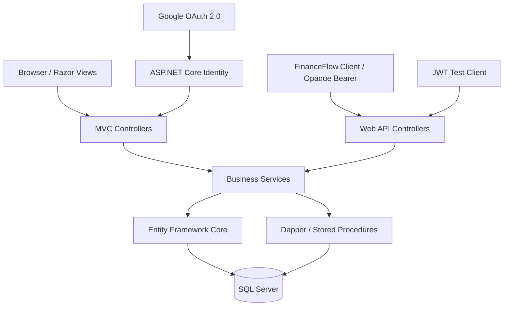

# FinanceFlow

## Project Overview

FinanceFlow is a finance request management and approval system built using ASP.NET Core, designed to streamline the creation, submission, review, and approval of financial requests within an organization.

The application implements role-based access control for three primary user roles: **Admin**, **Approver**, and **Requestor**, ensuring that users can access and perform actions according to their assigned permissions.

FinanceFlow demonstrates modern .NET development practices, including layered application design, authentication and authorization, database transactions, RESTful API development, optimistic concurrency control, and automated integration testing. The project includes **custom JWT bearer authentication** and **Google OAuth 2.0 external sign-in** as hands-on identity integration exercises.

The solution also includes a standalone .NET console client that communicates with the Web API using bearer token authentication and automatic token refresh.

## Tech Stack

| Category | Technologies |
|---|---|
| Framework | .NET 10, ASP.NET Core MVC, ASP.NET Core Web API |
| Language | C# |
| Frontend | Razor Views, HTML, CSS, Bootstrap, JavaScript |
| Database | Microsoft SQL Server |
| ORM & Data Access | Entity Framework Core, Dapper, ADO.NET |
| Authentication & Authorization | ASP.NET Core Identity, Cookies, Identity Opaque Bearer Tokens, JWT Bearer Authentication, Google OAuth 2.0 External Login, Role-Based and Resource-Based Authorization |
| API Communication | RESTful HTTP APIs, HttpClient |
| Testing | xUnit, ASP.NET Core Integration Testing, WebApplicationFactory |
| Development Tools | Visual Studio, SQL Server Management Studio, Git |

## Key Features

### Finance Request Management
- Create, edit, submit, approve, and reject finance requests.
- Track request statuses and approval history.
- Search, filter, and paginate finance requests.
- View financial request summaries through a dashboard.

### Authentication & Authorization
- ASP.NET Core Identity with MVC cookie authentication and **opaque Identity bearer access/refresh tokens** for the API client.
- Separately configured **JWT authentication** for demonstration endpoints, including signed tokens, claims, expiration, and issuer/audience/signature validation.
- **Google OAuth 2.0 external sign-in** integrated with ASP.NET Core Identity.
- Role-based and resource-based authorization, including separate policies for different API authentication schemes.
- Role-based login redirection and navigation.
- Administrative user activation and deactivation; external-login checks restrict access for deactivated accounts and prevent duplicate-email registrations.
- Security stamp validation and session invalidation for applicable Identity sessions.

### Database & Data Integrity
- Entity Framework Core with SQL Server.
- Dapper integration and stored procedures.
- Transaction management across EF Core and Dapper operations.
- Optimistic concurrency control using SQL Server `rowversion`.
- Database constraints and referential integrity.

### RESTful Web API
- Resource-based endpoints with appropriate HTTP methods and status codes.
- Identity opaque bearer access/refresh token flow for the existing API client.
- Separate JWT demonstration endpoints (`POST /api/auth/jwt/login` and `GET /api/auth/jwt/me`).
- Request validation and consistent error handling.
- HTTP 409 Conflict responses for concurrent updates.

### Standalone API Client
- Separate .NET console application using typed `HttpClient`.
- Authenticated GET, POST, and PUT operations.
- Automatic access token refresh and client-side logout.
- Secure local configuration using .NET User Secrets.

### Testing & Reliability
- Automated integration tests using xUnit and `WebApplicationFactory`.
- Authentication, authorization, workflow, and database integrity testing.
- SQL Server LocalDB tests for stored procedure and transaction behavior.

## Authentication Flows

FinanceFlow demonstrates **three distinct authentication paths**. These should not be confused with one another:

| Flow | Purpose | Implementation |
|---|---|---|
| MVC sign-in | Browser-based FinanceFlow access | ASP.NET Core Identity authentication cookies |
| API client sign-in | Authenticate `FinanceFlow.Client` calls | ASP.NET Core Identity **opaque** bearer access/refresh tokens; existing client auto-refreshes tokens |
| JWT API exercise | Generate and validate signed JWTs | Separately named `FinanceFlowJwt` bearer scheme and `ApiJwt` authorization policy |
| Google sign-in | Use an external Google account for MVC login | ASP.NET Core Google OAuth 2.0 handler linked to Identity accounts |

**JWT and Identity bearer tokens are different:** the existing console client's access token is an Identity **opaque token**, not a JWT. The JWT demonstration has its own login endpoint and does **not** automatically reuse the opaque-token refresh flow. Google sign-in is an external authorization/identity integration; the app does not implement a general-purpose OAuth 2.0 authorization server.

### JWT Demonstration Endpoints

| Method | Endpoint | Description |
|---|---|---|
| `POST` | `/api/auth/jwt/login` | Validate application credentials and return a signed JWT access token |
| `GET` | `/api/auth/jwt/me` | Return claims for a valid JWT (`Authorization: Bearer <token>`) |

The original Identity bearer endpoints (`/api/auth/login`, `/api/auth/refresh`, and protected finance-request API routes) remain available under their existing configuration.

### External Login Security

The Identity external login callback and registration confirmation flow include checks for existing users, duplicate email registration attempts, and `ApplicationUser.IsActive`. Reactivating an eligible account allows sign-in again. These checks were exercised manually during development; they are **not** a claim of comprehensive penetration testing or production security certification.

## System Architecture

FinanceFlow uses a layered application architecture that separates presentation, business logic, and data access responsibilities.

The solution supports two application clients: an ASP.NET Core MVC application with Razor Views and a standalone .NET console application that communicates with the RESTful Web API. Browser users can sign in with local credentials or Google; a separate JWT demonstration runs alongside the original opaque bearer token implementation.

Both MVC and Web API controllers use shared business services, while Entity Framework Core and Dapper provide database access to SQL Server. ASP.NET Core Identity manages authentication and authorization.


### Architecture Diagram



## Prerequisites

- .NET 10 SDK
- SQL Server (LocalDB or SQL Server instance)
- Visual Studio with ASP.NET and web development workload


### Database Configuration

FinanceFlow uses Microsoft SQL Server as its primary database.

Configure the connection string in the main application's `appsettings.json`.

Example using SQL Server LocalDB:

```json
{
  "ConnectionStrings": {
    "DefaultConnection": "Server=(localdb)\\MSSQLLocalDB;Database=FinanceFlowDb;Trusted_Connection=True;MultipleActiveResultSets=true"
  }
}
```

Ensure that the SQL Server instance is available before running database migrations.


### Database Migrations

FinanceFlow uses Entity Framework Core Code First migrations to manage the database schema.

To create or update the database:

1. Open the solution in Visual Studio.
2. Set `FinanceFlow` (ASP.NET Core MVC/Web API) as the Startup Project.
3. Open **Tools → NuGet Package Manager → Package Manager Console**.
4. Set the Default Project to `FinanceFlow`.
5. Run:

   ```powershell
   Update-Database
   ```

This applies pending EF Core migrations to the configured SQL Server database.


### Application Configuration

The FinanceFlow **server** uses configuration for JWT validation and Google external sign-in. The `FinanceFlow.Client` **console application** uses a separate `appsettings.json` for its API base URL and .NET User Secrets for development credentials.

**1. Configure server JWT settings**

In the server application's `appsettings.json`, add the following *non-secret* settings alongside the existing configuration:

```json
"Jwt": {
  "Issuer": "FinanceFlow",
  "Audience": "FinanceFlowApi",
  "ExpirationMinutes": 15
}
```

Store `Jwt:SigningKey` **only in server-side User Secrets** for local development. Generate a cryptographically random **32-byte** signing key (Base64-encoded); never put the key in the repository. In Visual Studio, right-click the **FinanceFlow server project → Manage User Secrets**.

**2. Configure Google OAuth 2.0 for local development**

1. In the [Google Auth Platform](https://console.cloud.google.com/auth/overview), select a Google Cloud project and configure Branding and Audience (use **External / Testing** for a personal test account).
2. Add the Google account under **Test users** when applicable. Keep data access limited to the identity scopes needed for sign-in (email/profile, and OpenID identity scopes if used by the configured client).
3. Create a **Web application** OAuth client.
4. Add the callback URI `https://localhost:7072/signin-google` to **Authorized redirect URIs**, replacing `7072` with the actual server HTTPS port in `Properties/launchSettings.json`.
5. Save the OAuth client ID and client secret to the **FinanceFlow server project's User Secrets**, for example:

```json
{
  "Jwt": {
    "SigningKey": "YOUR_RANDOM_BASE64_SIGNING_KEY"
  },
  "Authentication": {
    "Google": {
      "ClientId": "YOUR_GOOGLE_CLIENT_ID",
      "ClientSecret": "YOUR_GOOGLE_CLIENT_SECRET"
    }
  }
}
```

This is an **illustrative `secrets.json` structure**, not a file to commit. Retain any existing User Secrets entries. The server uses the Google handler (`AddGoogle`) and a separate JWT bearer scheme (`AddJwtBearer`) in addition to existing Identity authentication.

**3. Configure the console API Base URL**

In `FinanceFlow.Client/appsettings.json`:

```json
{
  "FinanceFlowApi": {
    "BaseUrl": "https://localhost:7072/"
  }
}
```

Update the URL to match the running FinanceFlow Web API.

**4. Configure console client User Secrets**

Open a terminal in the solution directory and run:

```powershell
dotnet user-secrets set "FinanceFlowCredentials:Email" "YOUR_EMAIL" --project FinanceFlow.Client
dotnet user-secrets set "FinanceFlowCredentials:Password" "YOUR_PASSWORD" --project FinanceFlow.Client
```

Make sure the console client's `DOTNET_ENVIRONMENT` is set to `Development`. For the ASP.NET Core server, check that the active launch profile uses `ASPNETCORE_ENVIRONMENT=Development` and that User Secrets are enabled for the server project.

**Security Notes**
- Never commit passwords, JWT signing keys, Google client secrets, access tokens, or refresh tokens to source control. Review staged changes before pushing.
- User Secrets are intended for **local development**, not production secret storage.
- For production, use environment variables or an appropriate secret management service, alongside a complete security review.
- A JWT is signed, **not encrypted**; do not place credentials or confidential business data in its payload.
- Demo JWT issuance does not include a full JWT refresh/revocation lifecycle. Identity cookie/session invalidation, external account controls, two-factor handling, and authorization policies require separate review for deployment.


### Running the Application

**1. Start the FinanceFlow Web Application**

1. Open the solution in Visual Studio.
2. Set `FinanceFlow` as the Startup Project.
3. Press `F5` to run the application.
4. The ASP.NET Core MVC application and Web API will run on the configured local URL.

**2. Run FinanceFlow.Client**

Keep the FinanceFlow Web API running.

From the `FinanceFlow` directory, open a separate terminal and execute:

```powershell
dotnet run --project ../FinanceFlow.Client/FinanceFlow.Client.csproj
```

Alternatively, navigate directly to the client project:

```powershell
cd ../FinanceFlow.Client
dotnet run
```

Ensure that the API Base URL and User Secrets are configured correctly before running the client.

**3. Test the Application**

- Log in using an existing FinanceFlow account.
- Navigate through the pages available to the assigned user role.
- Create and manage finance requests through the MVC application.
- Use FinanceFlow.Client to test authenticated API operations with the **Identity opaque bearer** flow.
- For JWT testing, send `POST /api/auth/jwt/login`, copy the `accessToken`, and call `GET /api/auth/jwt/me` with an `Authorization: Bearer <token>` header.
- For Google testing, go to `/Identity/Account/Login`, use the Google sign-in option, and confirm that active accounts can log in while deactivated accounts are denied access.

The console client supports automatic refresh of its **opaque Identity access token** when required; JWT demo tokens do not use that client refresh mechanism.

## Portfolio / Deployment Notes

This repository documents a hands-on .NET portfolio application. External Google sign-in and JWT examples were developed and tested locally. Before internet-facing deployment, review account provisioning, OAuth client restrictions, two-factor requirements, session/token revocation, rate limiting, key rotation, monitoring, and automated security tests. Do not treat the demo configurations above as production defaults.
