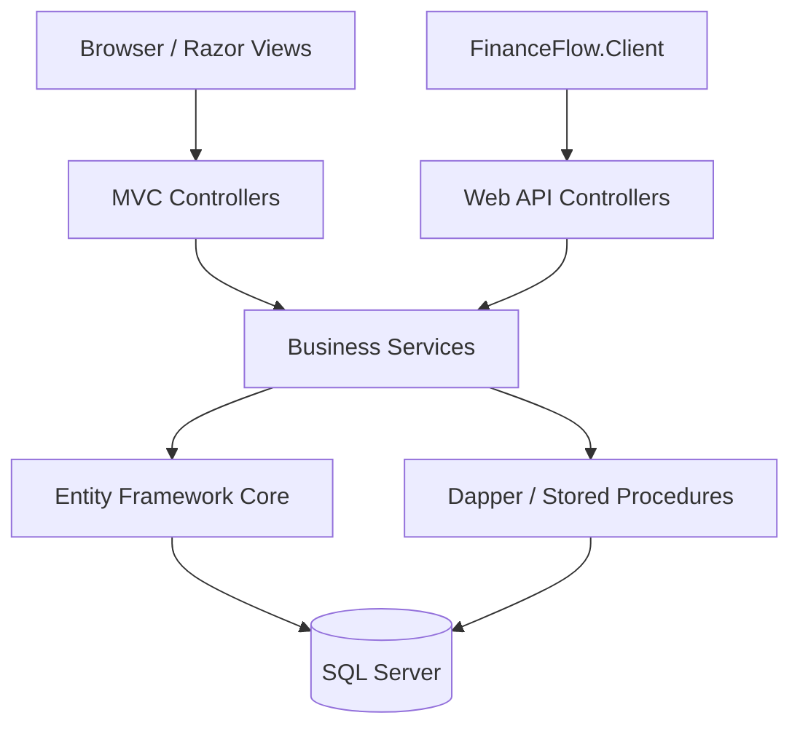

# FinanceFlow

## Project Overview

FinanceFlow is a finance request management and approval system built using ASP.NET Core, designed to streamline the creation, submission, review, and approval of financial requests within an organization.

The application implements role-based access control for three primary user roles: **Admin**, **Approver**, and **Requestor**, ensuring that users can access and perform actions according to their assigned permissions.

FinanceFlow demonstrates modern .NET development practices, including layered application design, secure authentication and authorization, database transactions, RESTful API development, optimistic concurrency control, and automated integration testing.

The solution also includes a standalone .NET console client that communicates with the Web API using bearer token authentication and automatic token refresh.

## Tech Stack

| Category | Technologies |
|---|---|
| Framework | .NET 10, ASP.NET Core MVC, ASP.NET Core Web API |
| Language | C# |
| Frontend | Razor Views, HTML, CSS, Bootstrap, JavaScript |
| Database | Microsoft SQL Server |
| ORM & Data Access | Entity Framework Core, Dapper, ADO.NET |
| Authentication & Authorization | ASP.NET Core Identity, Cookie Authentication, Bearer Token Authentication, Role-Based and Resource-Based Authorization |
| API Communication | RESTful HTTP APIs, HttpClient |
| Testing | xUnit, ASP.NET Core Integration Testing, WebApplicationFactory |
| Development Tools | Visual Studio, SQL Server Management Studio, Git |

## Key Features

### Finance Request Management
- Create, edit, submit, approve, and reject finance requests.
- Track request statuses and approval history.
- Search, filter, and paginate finance requests.
- View financial request summaries through a dashboard.

### Authentication & Authorization
- ASP.NET Core Identity with cookie and bearer token authentication.
- Role-based and resource-based authorization.
- Role-based login redirection and navigation.
- Administrative user activation and deactivation.
- Security stamp validation and session invalidation.

### Database & Data Integrity
- Entity Framework Core with SQL Server.
- Dapper integration and stored procedures.
- Transaction management across EF Core and Dapper operations.
- Optimistic concurrency control using SQL Server `rowversion`.
- Database constraints and referential integrity.

### RESTful Web API
- Resource-based endpoints with appropriate HTTP methods and status codes.
- Secure bearer token authentication and token refresh.
- Request validation and consistent error handling.
- HTTP 409 Conflict responses for concurrent updates.

### Standalone API Client
- Separate .NET console application using typed `HttpClient`.
- Authenticated GET, POST, and PUT operations.
- Automatic access token refresh and client-side logout.
- Secure local configuration using .NET User Secrets.

### Testing & Reliability
- Automated integration tests using xUnit and `WebApplicationFactory`.
- Authentication, authorization, workflow, and database integrity testing.
- SQL Server LocalDB tests for stored procedure and transaction behavior.

## System Architecture

FinanceFlow uses a layered application architecture that separates presentation, business logic, and data access responsibilities.

The solution supports two application clients: an ASP.NET Core MVC application with Razor Views and a standalone .NET console application that communicates with the RESTful Web API.

Both MVC and Web API controllers use shared business services, while Entity Framework Core and Dapper provide database access to SQL Server. ASP.NET Core Identity manages authentication and authorization.


### Architecture Diagram



## Prerequisites

- .NET 10 SDK
- SQL Server (LocalDB or SQL Server instance)
- Visual Studio with ASP.NET and web development workload


### Database Configuration

FinanceFlow uses Microsoft SQL Server as its primary database.

Configure the connection string in the main application's `appsettings.json`.

Example using SQL Server LocalDB:

```json
{
  "ConnectionStrings": {
    "DefaultConnection": "Server=(localdb)\\MSSQLLocalDB;Database=FinanceFlowDb;Trusted_Connection=True;MultipleActiveResultSets=true"
  }
}
```

Ensure that the SQL Server instance is available before running database migrations.


### Database Migrations

FinanceFlow uses Entity Framework Core Code First migrations to manage the database schema.

To create or update the database:

1. Open the solution in Visual Studio.
2. Set `FinanceFlow` (ASP.NET Core MVC/Web API) as the Startup Project.
3. Open **Tools → NuGet Package Manager → Package Manager Console**.
4. Set the Default Project to `FinanceFlow`.
5. Run:

   ```powershell
   Update-Database
   ```

This applies pending EF Core migrations to the configured SQL Server database.


### Application Configuration

The `FinanceFlow.Client` console application uses `appsettings.json` for API configuration and .NET User Secrets for local development credentials.

**1. Configure the API Base URL**

In `FinanceFlow.Client/appsettings.json`:

```json
{
  "FinanceFlowApi": {
    "BaseUrl": "https://localhost:7072/"
  }
}
```

Update the URL to match the running FinanceFlow Web API.

**2. Configure User Secrets**

Open a terminal in the solution directory and run:

```powershell
dotnet user-secrets set "FinanceFlowCredentials:Email" "YOUR_EMAIL" --project FinanceFlow.Client
dotnet user-secrets set "FinanceFlowCredentials:Password" "YOUR_PASSWORD" --project FinanceFlow.Client
```

Make sure `DOTNET_ENVIRONMENT` is set to `Development`.

**Security Notes**
- Never commit passwords or access tokens to source control.
- User Secrets are intended for local development, not production secret storage.
- For production, use environment variables or an appropriate secret management service.


### Running the Application

**1. Start the FinanceFlow Web Application**

1. Open the solution in Visual Studio.
2. Set `FinanceFlow` as the Startup Project.
3. Press `F5` to run the application.
4. The ASP.NET Core MVC application and Web API will run on the configured local URL.

**2. Run FinanceFlow.Client**

Keep the FinanceFlow Web API running.

From the `FinanceFlow` directory, open a separate terminal and execute:

```powershell
dotnet run --project ../FinanceFlow.Client/FinanceFlow.Client.csproj
```

Alternatively, navigate directly to the client project:

```powershell
cd ../FinanceFlow.Client
dotnet run
```

Ensure that the API Base URL and User Secrets are configured correctly before running the client.

**3. Test the Application**

- Log in using an existing FinanceFlow account.
- Navigate through the pages available to the assigned user role.
- Create and manage finance requests through the MVC application.
- Use FinanceFlow.Client to test authenticated API operations.

The console client supports automatic access token refresh when required.
